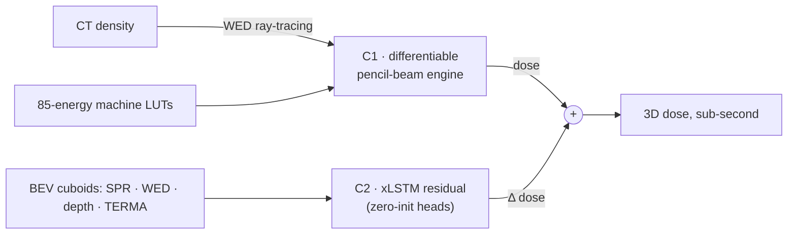
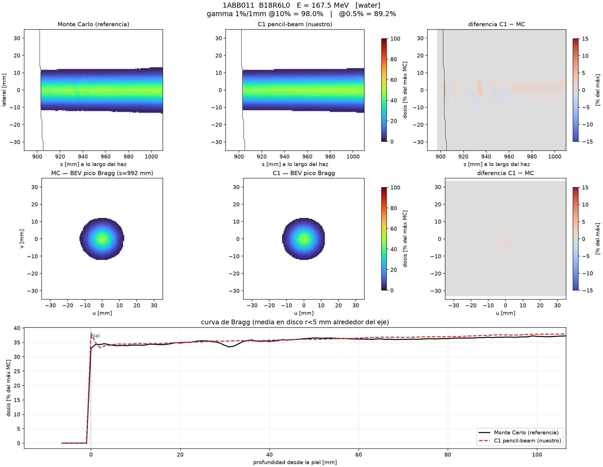
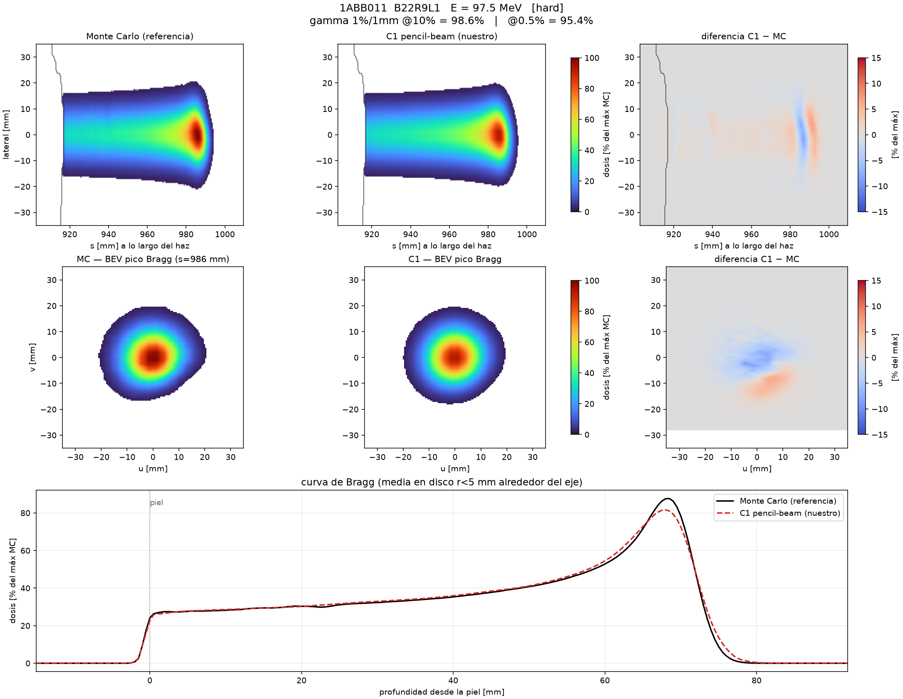
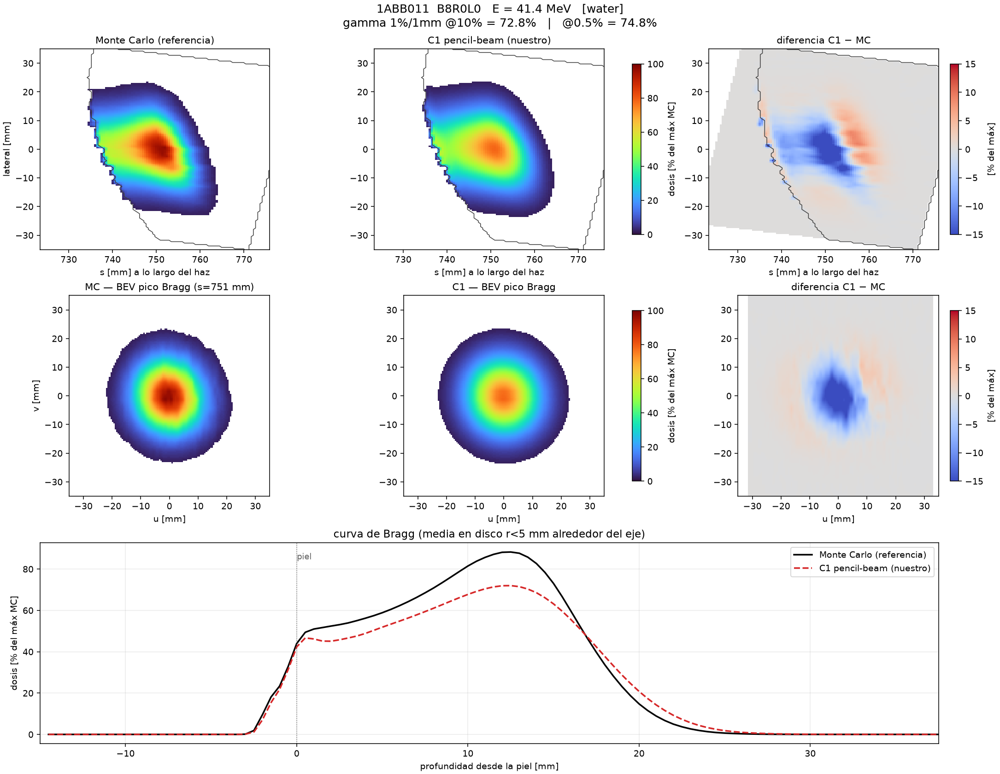

# NN-FastMC-Protonterapia

Neural fast Monte Carlo for pencil-beam-scanning (PBS) proton therapy: a
**differentiable pencil-beam engine** plus a **residual neural corrector**,
trained on the open DoseRAD2026 benchmark, with the goal of MC-level dose
accuracy in sub-second time.

*Status: research in progress, engine-calibration phase. This repository
documents the method and the current, honestly measured state of the engine.
The full implementation stays private during development and is available on
request.*

## The problem

Monte Carlo is the reference way to compute dose in PBS proton therapy, but
it is far too slow to sit inside a clinical planning loop. The bet of this
project: get the physics right analytically where you can, and let a neural
network learn only the residual — starting from zero, so the physics floor
is never lost.

## How it is built

**C1 — differentiable pencil-beam engine.** An analytical pencil beam built
on the machine's 85-energy lookup table, with water-equivalent-depth
ray-tracing through the CT density and lateral superposition kernels. It is
calibrated in two stages against Monte Carlo water data, and every step is
differentiable.

**C2 — residual corrector.** An xLSTM network over beam-eye-view volumes
(SPR, WED, radiological depth, TERMA channels) with zero-init heads: at step
zero its contribution is exactly 0.0, so the untrained system *is* the C1
engine. The corrector can only improve on the physics, never break it.

## Data

[DoseRAD2026](https://huggingface.co/datasets/LMUK-RADONC-PHYS-RES/DoseRAD2026)
— public benchmark (CC BY-NC 4.0): ~81,000 GATE/Geant4 single-beam dose
distributions with CT+MRI, covering the machine's 85 delivery energies.
Development runs locally on 10 patients; the campaign scale-up runs on the
IFCA Altamira cluster (SLURM).

## Results so far — C1 engine only, honestly measured

Validation on 12 held-out patients of the benchmark (277 beamlets evaluated
across three terrain types), current calibration chain, no neural corrector
yet:

| Terrain | γ 1%/1mm @10% (median pass rate) | γ 1%/1mm @0.5% | energies covered |
|---|---|---|---|
| Water | **93.3 %** | 91.2 % | 15/85 |
| Moderate | **94.7 %** | 91.0 % | 55/85 |
| Hard (heterogeneous) | **89.4 %** | 86.8 % | 41/85 |

R80 range error: **~0.3 mm** median across terrains. Split by energy (γ @10%):
water/moderate/hard = 83/87/72 % below 60 MeV, 94/93/92 % between 60–100 MeV,
and **97.5/97.7/96.2 %** above 100 MeV.

Against the project's formal gate (γ ≥ 98.8 % per energy) this is a **FAIL,
by design of the reporting**: the nuclear-tail behaviour beyond ~60 mm and
dose-to-medium in bone are documented engine limitations, deferred to the
corrector rather than patched into the calibration. The numbers above are
the physics floor that C2 has to improve on.

## What the engine output looks like

Example beamlets (validated calibration chain). Each figure: beam-eye-view
longitudinal dose (Monte Carlo reference vs engine, and their difference),
Bragg-peak cross-section, and the depth-dose curve. Figure titles show the
per-beamlet γ 1%/1mm pass rates at the 10% and 0.5% dose cuts.

| | |
|---|---|
| High-energy beamlet in water, γ@10% = 98.0 % | Same energy, heterogeneous terrain, γ@10% = 98.6 % |
|  |  |
| Low-energy beamlet in water, γ@10% = 72.8 % — a documented hard regime | |
|  | |

## How the project is run

- **Test-driven**: 363 tests, all passing; physics gates are pre-registered
  tests, not post-hoc plots.
- **Adversarial audits**: six rounds of external code+physics review; every
  finding tracked to closure.
- **Fail-closed provenance**: the data loader aborts if the calibration, the
  code or any Monte Carlo provenance field changes silently.
- **Units and geometry are invariants**, not implementation details.

## What is next

1. Campaign-scale calibration of C1 on IFCA (all 85 energies).
2. First real training of the C2 corrector (bf16, multi-GPU).
3. Calibrated uncertainty (evidential + conformal), then the differentiable
   inverse-planning loop.

## Code availability

The core implementation is private during development (data governance plus
research in progress) and available on request. I am happy to walk through
the architecture over a call.

**Ibón García Gómez** — MSc Particle Physics (U. Cantabria), research at
IFCA-CSIC · [ibongarcia.com](https://ibongarcia.com) ·
ibon@ibongarcia.com
